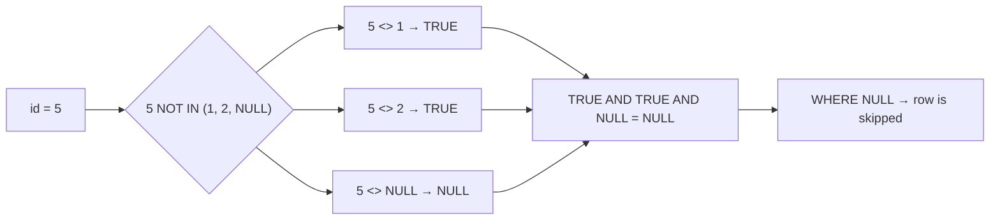

<!-- IMG: img-01 -->

A reviewer left a familiar comment on my migration: "switch `IN` to `EXISTS`, it's faster."
So I measured it. `IN`, `EXISTS`, `USING`: Postgres runs all three with the exact same plan. The differences are noise.

The scary part was somewhere nobody commented on: `NOT IN`.
One `NULL` row, and the DELETE removes… zero rows. No error, no warning.
And once the table grows a little, it jumps from 29 ms to over 2 minutes.

## One job, three ways to write it, and an argument

Take a problem every codebase has: an `orders` table and an `order_items` table. When an order is cancelled, delete its items.

The first version, the one I wrote on autopilot, uses `IN`:

```sql
delete from order_items
where order_id in (select id from orders where status = 'cancelled');
```

The second, `EXISTS`, is what the reviewer suggested:

```sql
delete from order_items i
where exists (select 1 from orders o where o.id = i.order_id and o.status = 'cancelled');
```

The third, `USING`, is Postgres's own syntax for a DELETE with a join:

```sql
delete from order_items i
using orders o
where o.id = i.order_id and o.status = 'cancelled';
```

Three queries, one job. Instead of arguing about which is faster, I made them race.
I ran Postgres 18.7 in a devcontainer and loaded 200,000 orders and 950,000 items.
One order in ten is cancelled, so every query has to delete exactly 100,000 items.
The data is generated for the test, not production numbers.
Each query ran under `EXPLAIN ANALYZE` inside `BEGIN … ROLLBACK` so the data stayed intact, three times, taking the median.

## Is EXISTS really faster than IN?

Before measuring, I was half convinced. The explanation I got sounded very reasonable:
`IN` runs the subquery first, builds a big list, then checks every row against it.
`EXISTS` is smarter: it checks row by row and stops at the first match.
It sounded so reasonable that I nearly changed the code without measuring anything.

But that's how *I read* the SQL. How Postgres *runs* it is a question for `EXPLAIN`. Here is the plan for the `IN` version:

```text
Delete on order_items (actual time=120.559..120.560 rows=0.00 loops=1)
  Buffers: shared hit=106218
  ->  Hash Join (actual time=7.471..101.665 rows=100000.00 loops=1)
        Hash Cond: (order_items.order_id = orders.id)
        ->  Seq Scan on order_items (actual time=0.004..52.265 rows=950000.00 loops=1)
        ->  Hash (actual time=7.461..7.462 rows=20000.00 loops=1)
              ->  Seq Scan on orders (actual time=0.002..6.243 rows=20000.00 loops=1)
                    Filter: (status = 'cancelled'::text)
```

The plans for `EXISTS` and `USING` match it line for line, apart from the aliases.
Same `Hash Join`, same `shared hit=106218`, so all three touch exactly the same number of pages.
There is no "build a list" step and no "stop at the first match" step.

| Query | Plan | Time (median) |
|---|---|---|
| `IN` | Hash Join | 120.6 ms |
| `EXISTS` | Hash Join | 139.0 ms |
| `USING` | Hash Join | 116.2 ms |

By this table, `EXISTS` is actually the slowest. Don't crown `IN` yet: I dropped the index on `order_items(order_id)` and ran it again.
This time `EXISTS` won: 119.1 ms, `USING` 120.5 ms, `IN` 124.9 ms.
The ranking shuffles between runs, because when the plan is the same, the difference is noise.

The reason is the planner. When it sees `IN (subquery)` or `EXISTS (subquery)` in a `WHERE` clause, Postgres pulls the subquery up into a semi-join, then picks a join strategy like it would for any other join.
Here `orders.id` is the primary key, so each item matches at most one order, and the planner reduces the semi-join to a plain join. That is exactly what `USING` spells out by hand.
Both steps are right there in the Postgres source: [`pull_up_sublinks`](https://github.com/postgres/postgres/blob/master/src/backend/optimizer/prep/prepjointree.c) and [`reduce_unique_semijoins`](https://github.com/postgres/postgres/blob/master/src/backend/optimizer/plan/analyzejoins.c).

So for a positive condition, "delete the rows that *have* a match", choosing between `IN`, `EXISTS` and `USING` is about readability.
Not speed. Three different outfits, one skeleton.

## NOT IN: one NULL and the DELETE deletes… nothing

Now flip the problem: delete the orders that *no longer* have any items. The test data has 10,000 of them.
On autopilot, the counterpart of `IN` is `NOT IN`, and the counterpart of `EXISTS` is `NOT EXISTS`:

```sql
-- NOT IN
delete from orders
where id not in (select order_id from order_items);

-- NOT EXISTS
delete from orders o
where not exists (select 1 from order_items i where i.order_id = o.id);
```

The `order_items.order_id` column is nullable. With no `NULL` rows, both queries delete exactly 10,000 orders.
I added **one** item with `order_id = NULL` and ran them again:

| Query | Orders deleted |
|---|---|
| `NOT IN` | **0** |
| `NOT EXISTS` | 10,000 |

No error, no warning. It just quietly deletes nothing.

The cause is SQL's three-valued logic. `id not in (1, 2, NULL)` means `id <> 1 AND id <> 2 AND id <> NULL`.
Comparing anything to `NULL` gives `NULL`, not `TRUE`. The whole expression can never be `TRUE`, so no row qualifies.
The Postgres docs spell this out in [Subquery Expressions](https://www.postgresql.org/docs/current/functions-subquery.html), and the Postgres wiki lists `NOT IN` under [Don't Do This](https://wiki.postgresql.org/wiki/Don%27t_Do_This#Don.27t_use_NOT_IN).
`NOT EXISTS` is immune, because it only asks "is there a matching row?", and `NULL = 5` is not a match.

<!-- IMG: img-02 -->


## 5,000 more orders, from 29 ms to over 2 minutes

Wrong results are bad enough. But even with no `NULL` anywhere, `NOT IN` has a second trap: speed.

To preserve the `NULL` semantics above, Postgres here does not turn `NOT IN` into an anti-join the way it does with `NOT EXISTS`.
That leaves two options. If the planner estimates that the whole subquery result fits in `work_mem`, it builds a hash table (`hashed SubPlan`) and runs fast.
If not, it rescans the list for **every row** of the outer table:

```text
Delete on orders
  ->  Seq Scan on orders
        Filter: (NOT (ANY (id = (SubPlan 1).col1)))
        SubPlan 1
          ->  Materialize
                ->  Seq Scan on order_items
```

The second option means billions of comparisons. To find where it kicks in, I kept the default 4MB `work_mem` and grew the data step by step:

| orders | order_items | `NOT IN` plan | `NOT IN` | `NOT EXISTS` |
|---|---|---|---|---|
| 25,000 | 118,750 | hashed SubPlan | 13 ms | 14 ms |
| 50,000 | 237,500 | hashed SubPlan | 28 ms | 28 ms |
| 55,000 | 261,250 | hashed SubPlan | 29 ms | 31 ms |
| 60,000 | 285,000 | SubPlan (not hashed) | > 120 s | 34 ms |
| 70,000 | 332,500 | SubPlan (not hashed) | > 120 s | 45 ms |

This isn't a gentle slope. It's a cliff.
Below the threshold, `NOT IN` is as fast as `NOT EXISTS`. Add 9% more data and it runs past 2 minutes before I kill it, while `NOT EXISTS` still takes 34 ms.

This is the scariest part. On a dev machine with small tables, the `NOT IN` query flies and nobody in review notices anything.
In production the table keeps growing, one day it crosses the threshold, and the plan silently switches.
Nobody changed the code. Only the data grew.

Raising `work_mem` to 64MB does bring `NOT IN` back to 138 ms at 950,000 items.
But that only moves the cliff further away, it doesn't flatten it, and it does nothing about `NULL`.

## So which one should you write?

My migration kept `IN`. With identical plans there's no speed reason to change it, and `IN` is the shortest version: you read it once and you get it.

The rules I now follow:

- **Positive conditions** (delete or update rows that *have* a match): pick for readability. One column, `IN` is shortest. Multi-column conditions, `EXISTS`. Need columns from the other table, for example in `RETURNING`, use `USING`.
- **Negative conditions** (rows with *no* match): always `NOT EXISTS`. I haven't seen a case where `NOT IN (subquery)` is worth keeping.

There are trade-offs. `USING` is Postgres-only syntax; MySQL has multi-table DELETE too, but written differently, so switching databases means rewriting it.
`EXISTS` is longer and forces you to use aliases.

To be fair about the limits of this test: one Postgres version, one data shape, a container on a laptop.
Don't compare the absolute milliseconds to your machine. What holds up is the shape of the plans and the ratios between queries.
MySQL, SQL Server and Oracle are out of scope here. Their planners have their own personalities.

## Before rewriting a query "for speed", ask EXPLAIN

Next time someone says "switch to `EXISTS`, it's faster", don't argue and don't rush to change it.
Run `EXPLAIN ANALYZE` on both versions with enough data, and put the two plans side by side. If the plans match, the debate is over: keep whichever reads better.

Wrap it in a transaction. `EXPLAIN ANALYZE` really executes the statement, and for a DELETE that means really deleting:

```sql
begin;
explain analyze delete from order_items where order_id in (select id from orders where status = 'cancelled');
rollback;
```

One more thing worth doing today. It takes about a minute:

```bash
grep -rniE "not in \([[:space:]]*select" src/ migrations/
```

Every hit is a place that can fall into one of the two traps above: a single `NULL`, or the day the table outgrows `work_mem`. Rewrite it as `NOT EXISTS`.

The test script, so you can run it yourself: [IN / EXISTS / NOT IN lab gist](https://gist.github.com/thientuquangtrung/358803972e091ff910a79e2d9667b1c3).
Run it on your machine. Your planner may have a personality of its own.
