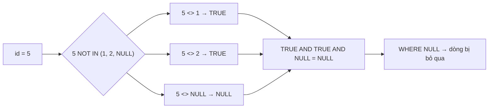

<!-- IMG: img-01 -->

Lúc review migration, mình nhận một góp ý quen thuộc: "đổi `IN` sang `EXISTS` đi, nhanh hơn đấy".
Mình đo thử. `IN`, `EXISTS`, `USING`: Postgres chạy cả ba theo đúng một plan, chênh nhau chỉ là nhiễu.

Thứ đáng sợ lại nằm ở chỗ chẳng ai góp ý: `NOT IN`.
Một dòng `NULL` thôi là câu DELETE xoá… 0 dòng. Không lỗi, không cảnh báo.
Còn khi bảng lớn thêm một chút, nó nhảy từ 29 ms lên hơn 2 phút.

## Một việc, ba cách viết, và một cuộc tranh luận

Lấy một bài toán nhà nào cũng có: bảng `orders` và bảng `order_items`. Đơn nào đã huỷ thì dọn sạch item của đơn đó.

Cách đầu tiên, cũng là cách mình viết theo phản xạ, là `IN`:

```sql
delete from order_items
where order_id in (select id from orders where status = 'cancelled');
```

Cách thứ hai, `EXISTS`, cách được người review gợi ý:

```sql
delete from order_items i
where exists (select 1 from orders o where o.id = i.order_id and o.status = 'cancelled');
```

Cách thứ ba, `USING`, đặc sản riêng của Postgres để DELETE kèm join:

```sql
delete from order_items i
using orders o
where o.id = i.order_id and o.status = 'cancelled';
```

Ba câu, cùng một việc. Thay vì cãi nhau xem câu nào nhanh hơn, mình cho chúng nó thi thật.
Mình dựng Postgres 18.7 trong devcontainer, đổ vào 200.000 đơn và khoảng 950.000 item.
Cứ 10 đơn thì 1 đơn huỷ, nên câu nào cũng phải xoá đúng 100.000 item.
Dữ liệu này mình tự sinh để thử, không phải số production.
Mỗi câu chạy `EXPLAIN ANALYZE` trong `BEGIN … ROLLBACK` cho dữ liệu còn nguyên, lặp 3 lần lấy trung vị.

## EXISTS nhanh hơn IN thật à?

Trước khi đo, mình nửa tin nửa ngờ. Lời giải thích mình nhận được nghe xuôi tai cực:
`IN` chạy subquery trước, gom thành một danh sách to tướng rồi đem từng dòng ra dò.
`EXISTS` thì tinh ranh hơn, kiểm từng dòng, thấy khớp là nghỉ ngay.
Nghe hợp lý tới mức mình suýt sửa code luôn mà không cần đo =))

Nhưng đó là cách *mình đọc* câu SQL. Postgres *chạy* nó thế nào thì phải hỏi `EXPLAIN`. Đây là plan của câu `IN`:

```text
Delete on order_items (actual time=120.559..120.560 rows=0.00 loops=1)
  Buffers: shared hit=106218
  ->  Hash Join (actual time=7.471..101.665 rows=100000.00 loops=1)
        Hash Cond: (order_items.order_id = orders.id)
        ->  Seq Scan on order_items (actual time=0.004..52.265 rows=950000.00 loops=1)
        ->  Hash (actual time=7.461..7.462 rows=20000.00 loops=1)
              ->  Seq Scan on orders (actual time=0.002..6.243 rows=20000.00 loops=1)
                    Filter: (status = 'cancelled'::text)
```

Plan của `EXISTS` và `USING` giống hệt từng dòng, chỉ khác alias.
Cùng một `Hash Join`, cùng `shared hit=106218`, tức là cả ba đọc đúng chừng ấy page.
Không có bước "gom danh sách" nào, cũng không có bước "thấy khớp là nghỉ" nào.

| Cách viết | Plan | Thời gian (trung vị) |
|---|---|---|
| `IN` | Hash Join | 120,6 ms |
| `EXISTS` | Hash Join | 139,0 ms |
| `USING` | Hash Join | 116,2 ms |

Nhìn bảng thì `EXISTS` còn chậm nhất. Đừng vội mừng hộ `IN`: mình xoá index trên `order_items(order_id)` rồi đo lại.
Lần này `EXISTS` về nhất: 119,1 ms, `USING` 120,5 ms, `IN` 124,9 ms.
Thứ hạng đổi lung tung giữa các lần chạy, vì cùng một plan thì chênh lệch chỉ là nhiễu.

Lý do nằm ở planner. Gặp `IN (subquery)` hay `EXISTS (subquery)` trong `WHERE`, Postgres kéo subquery lên thành một semi-join, rồi chọn cách join như với mọi join khác.
Ở đây `orders.id` là khoá chính, mỗi item khớp tối đa một đơn, nên planner hạ tiếp semi-join thành join thường. Đó đúng là thứ `USING` viết ra bằng tay.
Hai bước này nằm ngay trong mã nguồn Postgres: [`pull_up_sublinks`](https://github.com/postgres/postgres/blob/master/src/backend/optimizer/prep/prepjointree.c) và [`reduce_unique_semijoins`](https://github.com/postgres/postgres/blob/master/src/backend/optimizer/plan/analyzejoins.c).

Tóm lại, với câu khẳng định "xoá những dòng *có* liên quan", chọn `IN`, `EXISTS` hay `USING` là chuyện đọc có sướng mắt không.
Không phải chuyện tốc độ. Ba anh em này khác áo chứ chung một bộ xương.

## NOT IN: một dòng NULL là xoá sạch… không gì cả

Giờ đảo bài toán lại: xoá những đơn *không còn* item nào. Trong dữ liệu thử, 10.000 đơn như vậy.
Theo phản xạ, cặp đôi của `IN` là `NOT IN`, của `EXISTS` là `NOT EXISTS`:

```sql
-- NOT IN
delete from orders
where id not in (select order_id from order_items);

-- NOT EXISTS
delete from orders o
where not exists (select 1 from order_items i where i.order_id = o.id);
```

Cột `order_items.order_id` cho phép `NULL`. Chưa có dòng `NULL` nào thì cả hai câu đều xoá đúng 10.000 đơn.
Mình thêm đúng **một** item có `order_id = NULL` rồi chạy lại:

| Câu | Số đơn bị xoá |
|---|---|
| `NOT IN` | **0** |
| `NOT EXISTS` | 10.000 |

Không lỗi, không cảnh báo. Chỉ lặng lẽ không xoá gì.

Lý do là logic ba giá trị của SQL. `id not in (1, 2, NULL)` nghĩa là `id <> 1 AND id <> 2 AND id <> NULL`.
So bất cứ thứ gì với `NULL` đều ra `NULL`, không phải `TRUE`. Cả biểu thức không bao giờ là `TRUE`, nên không dòng nào bị xoá.
Docs Postgres ghi rõ hành vi này ở [mục Subquery Expressions](https://www.postgresql.org/docs/current/functions-subquery.html), và wiki của Postgres xếp `NOT IN` vào danh sách [Don't Do This](https://wiki.postgresql.org/wiki/Don%27t_Do_This#Don.27t_use_NOT_IN).
`NOT EXISTS` không dính, vì nó chỉ hỏi "có dòng nào khớp không", và `NULL = 5` không khớp.

<!-- IMG: img-02 -->


## Thêm 5.000 đơn, từ 29 ms thành hơn 2 phút

Sai kết quả đã đủ tệ. Nhưng kể cả khi không có `NULL` nào, `NOT IN` vẫn còn một cái bẫy về tốc độ.

Vì phải giữ đúng ngữ nghĩa `NULL` ở trên, ở đây Postgres không biến `NOT IN` thành anti-join như cách nó làm với `NOT EXISTS`.
Nó chỉ còn hai đường. Nếu planner ước lượng cả danh sách từ subquery vừa trong `work_mem`, nó dựng một bảng hash (`hashed SubPlan`) và chạy nhanh.
Nếu không vừa, nó quét lại danh sách cho **từng dòng** của bảng ngoài:

```text
Delete on orders
  ->  Seq Scan on orders
        Filter: (NOT (ANY (id = (SubPlan 1).col1)))
        SubPlan 1
          ->  Materialize
                ->  Seq Scan on order_items
```

Đường thứ hai nghĩa là hàng tỷ phép so. Để thấy nó rơi vào lúc nào, mình giữ `work_mem` mặc định 4MB rồi tăng dần cỡ dữ liệu:

| orders | order_items | plan của `NOT IN` | `NOT IN` | `NOT EXISTS` |
|---|---|---|---|---|
| 25.000 | 118.750 | hashed SubPlan | 13 ms | 14 ms |
| 50.000 | 237.500 | hashed SubPlan | 28 ms | 28 ms |
| 55.000 | 261.250 | hashed SubPlan | 29 ms | 31 ms |
| 60.000 | 285.000 | SubPlan (không hash) | > 120 s | 34 ms |
| 70.000 | 332.500 | SubPlan (không hash) | > 120 s | 45 ms |

Không phải dốc thoai thoải. Là vách đá.
Dưới ngưỡng, `NOT IN` nhanh ngang `NOT EXISTS`. Thêm 9% dữ liệu, nó chạy quá 2 phút thì mình cắt, trong khi `NOT EXISTS` vẫn 34 ms.

Đây mới là chỗ đáng sợ nhất. Ở máy dev, bảng nhỏ, câu `NOT IN` chạy vèo vèo, review không ai thấy gì.
Lên production, bảng lớn dần, một ngày nó vượt ngưỡng và plan lặng lẽ đổi đường.
Không ai sửa code, chỉ có dữ liệu lớn lên.

Tăng `work_mem` lên 64MB thì ở cỡ 950.000 item, `NOT IN` về lại 138 ms thật.
Nhưng đó là dời vách đá ra xa chứ không san phẳng được nó, và vẫn không chữa được chuyện `NULL`.

## Vậy rốt cuộc viết kiểu nào?

Migration của mình cuối cùng giữ nguyên `IN`. Plan đã giống hệt nhau thì không có lý do tốc độ nào để đổi, và `IN` là câu gọn nhất, đọc một lần là hiểu.

Quy tắc mình rút ra cho chính mình:

- **Câu khẳng định** (xoá/sửa những dòng *có* liên quan): chọn theo độ dễ đọc. So một cột thì `IN` gọn nhất. Điều kiện nhiều cột thì `EXISTS`. Cần dùng cột của bảng kia, ví dụ trong `RETURNING`, thì `USING`.
- **Câu phủ định** (những dòng *không có* liên quan): luôn `NOT EXISTS`. Mình chưa thấy trường hợp nào đáng để giữ `NOT IN (subquery)`.

Đánh đổi thì vẫn có. `USING` là cú pháp riêng của Postgres; MySQL cũng có DELETE nhiều bảng nhưng viết kiểu khác, nên đổi DB là phải viết lại.
`EXISTS` thì dài hơn và bắt phải đặt alias.

Giới hạn của phép đo cũng nói luôn cho sòng phẳng: một phiên bản Postgres, một kiểu dữ liệu, chạy trong container trên laptop.
Số mili giây tuyệt đối đừng mang đi so với máy bạn. Thứ đáng tin là hình dạng plan và tỉ lệ giữa các câu.
MySQL, SQL Server hay Oracle không nằm trong bài này, planner của chúng có tính khí riêng.

## Trước khi đổi query "cho nhanh", hỏi EXPLAIN đã

Lần tới có ai bảo "đổi sang `EXISTS` cho nhanh", bạn đừng cãi và cũng đừng sửa vội.
Chạy `EXPLAIN ANALYZE` cả hai bản trên dữ liệu đủ lớn rồi đặt hai plan cạnh nhau. Plan giống nhau thì tranh luận xong, giữ bản nào dễ đọc hơn.

Nhớ bọc trong transaction. `EXPLAIN ANALYZE` chạy thật câu lệnh, với DELETE nghĩa là xoá thật:

```sql
begin;
explain analyze delete from order_items where order_id in (select id from orders where status = 'cancelled');
rollback;
```

Còn một việc nên làm ngay hôm nay, mất chừng một phút:

```bash
grep -rniE "not in \([[:space:]]*select" src/ migrations/
```

Mỗi kết quả là một chỗ có thể dính một trong hai cái bẫy ở trên: một dòng `NULL`, hoặc ngày bảng vượt `work_mem`. Đổi nó sang `NOT EXISTS`.

Script thí nghiệm để bạn tự chạy: [gist lab IN / EXISTS / NOT IN](https://gist.github.com/thientuquangtrung/358803972e091ff910a79e2d9667b1c3).
Đo trên máy bạn, biết đâu planner nhà bạn có tính khí khác =))
